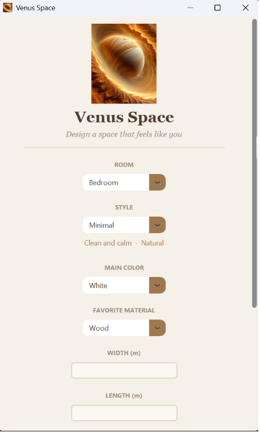
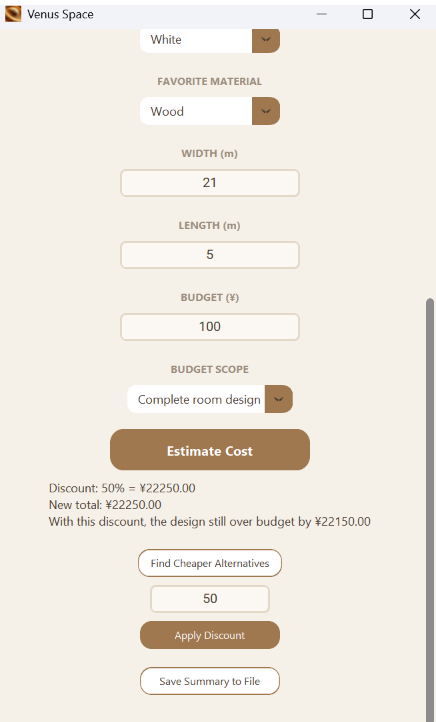
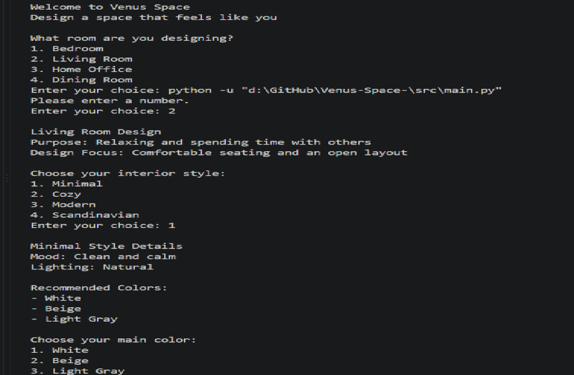
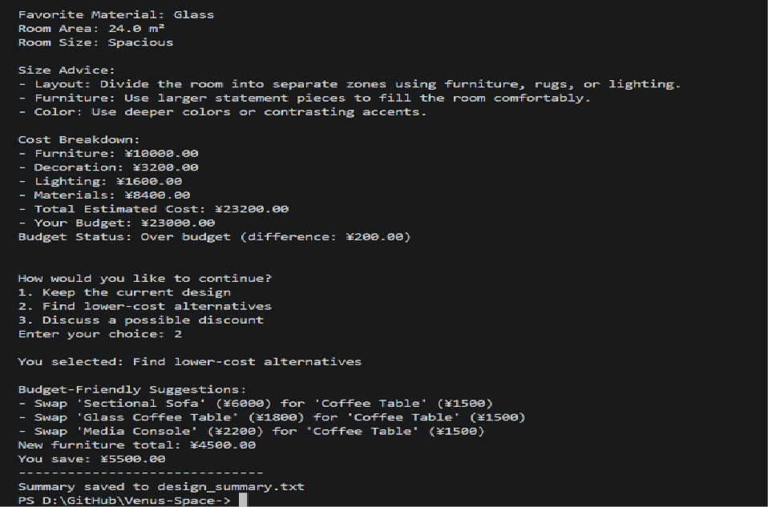
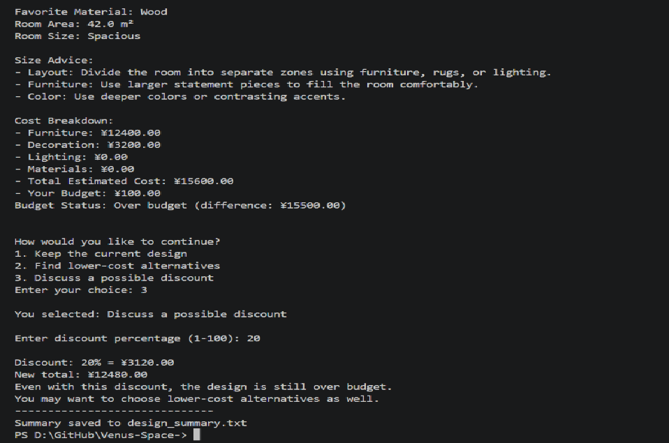

# Venus Space 🏠🪐

An interior design assistant written in Python — available as a **modern window app (GUI)** and a **command-line version**.

Venus Space helps clients design rooms by recommending styles, colors, materials and furniture, then estimates the total cost and compares it against the client's budget.

## Screenshots

### GUI Version (customtkinter)




### CLI Version





## Features

- 4 rooms: Bedroom, Living Room, Home Office, Dining Room
- 4 interior styles: Minimal, Cozy, Modern, Scandinavian
- Style-based color and material recommendations (dropdowns update automatically when the style changes)
- Room size classification (Compact / Medium / Spacious) with layout advice
- Cost estimation: furniture, decoration, lighting, and materials (per m²)
- Budget comparison with difference amount
- Over-budget tools: cheaper alternatives and discount calculation
- Saves a design summary to a text file (`design_summary.txt`)
- Multi-room project mode (CLI): design a whole apartment with one combined budget
- Custom warm theme with app logo and taskbar icon

## How to Run

1. Install Python 3, then install the one dependency:

   ```
   pip install -r requirements.txt
   ```

2. Clone this repository:

   ```
   git clone [https://github.com/SAMARHAJJAJI/Venus-Space-.git]
   ```

3. Run the GUI version:

   ```
   cd Venus-Space-/src
   python gui.py
   ```

   Or run the command-line version:

   ```
   python main.py
   ```

## Project Structure

```
src/
├── gui.py           # window app (customtkinter)
├── main.py          # command-line version (multi-room projects)
├── helpers.py       # input validation helpers
├── styles.py        # interior styles data
├── data.py          # rooms, recommendations, budget options
├── furniture.py     # furniture prices by room
├── decorations.py   # decoration prices
├── design_costs.py  # lighting and material prices
└── reports.py       # saves summary to file

assets/              # app logo images
docs/screenshots/    # README images
```

## Technologies

- Python 3
- customtkinter (GUI library — see `requirements.txt`)
- CLI version uses only the Python standard library

## Author

[SAMAR HAJJAJI] — Computer Science and Technology, NJUPT

## Version History

- **v3.0** — GUI version (customtkinter): dynamic form, over-budget actions, custom theme, logo
- **v2.0** — Multi-room project mode with combined budget
- **v1.0** — First CLI release: design flow, cost estimation, budget handling, file export